<div align="center">

# PaperTrail Evidence Lab

### Evidence-First Document Intelligence & RAG Reliability Platform

> **"Every important answer must be traceable to its source evidence."**

[](https://nextjs.org/)
[](https://www.typescriptlang.org/)
[](https://supabase.com/)
[](https://ai.google.dev/)
[](https://vitest.dev/)
[](https://tailwindcss.com/)
[](LICENSE)
[]()

**PaperTrail Evidence Lab** is a professional document-intelligence platform engineered to **eliminate the illusion of AI confidence**. It decomposes generated answers into atomic factual claims, verifies exact-quote citations against underlying document passages, flags citation mismatches, analyzes cross-document contradictions, and triggers explicit answer **abstention** when evidence is missing or conflicting.

</div>

---

## Table of Contents

1. [Why PaperTrail?](#1-why-papertrail)
2. [Core Capabilities at a Glance](#2-core-capabilities-at-a-glance)
3. [System Architecture](#3-system-architecture)
4. [Evidence Lens™ — Claim-Level Verification Pipeline](#4-evidence-lens-claim-level-verification-pipeline)
5. [Evidence Lineage Graph](#5-evidence-lineage-graph)
6. [Contradiction & Change-Impact Analysis](#6-contradiction--change-impact-analysis)
7. [Developer Regression Lab & Adversarial Stress Tests](#7-developer-regression-lab--adversarial-stress-tests)
8. [End-to-End Request Lifecycle](#8-end-to-end-request-lifecycle)
9. [Database Schema (ERD)](#9-database-schema-erd)
10. [Security & Multi-Tenancy Model](#10-security--multi-tenancy-model)
11. [Editorial Design Language](#11-editorial-design-language)
12. [Project Structure](#12-project-structure)
13. [Quick Start](#13-quick-start)
14. [Automated Tests](#14-automated-tests)
15. [Database Migrations](#15-database-migrations)
16. [Deployment](#16-deployment)
17. [Roadmap](#17-roadmap)
18. [Contributing](#18-contributing)
19. [License](#19-license)

---

## 1. Why PaperTrail?

Modern RAG systems are remarkably confident — and remarkably unverifiable. They surface fluent answers with citations that *look* authoritative but often **paraphrase, fabricate, or contradict** the very source they claim to quote. In regulated domains — clinical research, legal evidence, judicial archives, compliance audits — that gap is unacceptable.

PaperTrail closes it by treating **every answer as a chain of evidence** rather than a single text blob.

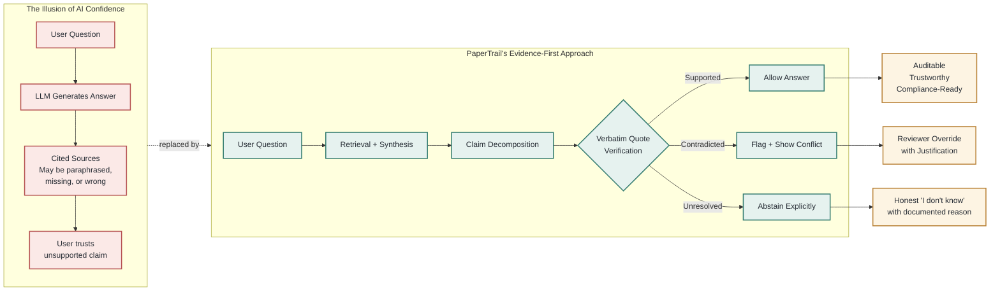

The result is a research platform where **every important answer can be traced back to its exact passage** — verifiable, auditable, and aligned with the editorial discipline of clinical research publishing and judicial evidence archives.

---

## 2. Core Capabilities at a Glance

| # | Capability | What it does | Primary user |
|---|-----------|--------------|--------------|
| 1 | **Evidence Lens™** | Decomposes answers into atomic claims; verifies each citation against indexed passages | Student / Reviewer |
| 2 | **Evidence Lineage Graph** | Visualizes the full chain: inquiry → chunks → synthesis → claims → citations → assessment | Reviewer / Auditor |
| 3 | **Contradiction & Change Impact** | Detects factual conflicts across document versions; flags downstream dependencies as `needs_review` | Compliance / Editor |
| 4 | **Developer Regression Lab** | Automated benchmarks + adversarial stress tests across retrieval parameters | Developer / ML Engineer |
| 5 | **Multi-Format Audit Export** | One-click JSON / CSV / styled HTML export of the complete evidence audit package | Compliance / Auditor |

---

## 3. System Architecture

PaperTrail is layered as a **vertical stack**: presentation and workspaces on top, evidence-aware intelligence in the middle, a hardened RAG core below, and external data providers at the base.

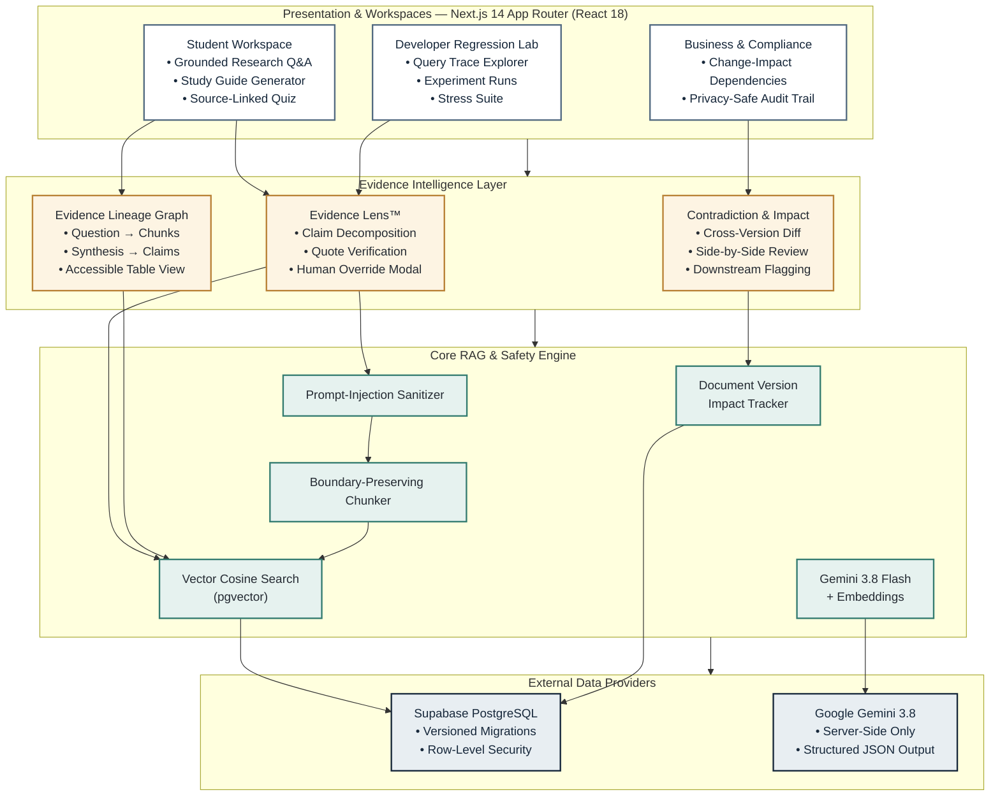

**Key architectural principles:**

- **Strict server/client boundary** — privileged secrets (`GEMINI_API_KEY`) are enforced server-side in `src/lib/config/env.ts`; runtime exceptions are thrown if accessed in browser code.
- **Workspace isolation** — every database table that touches tenant data is governed by Row-Level Security (RLS) policies.
- **Verifiable citation discipline** — synthesis output is structured JSON, not free text, so every claim carries an explicit citation pointer that can be validated programmatically.

---

## 4. Evidence Lens™ — Claim-Level Verification Pipeline

The Evidence Lens™ is the heart of the platform. It refuses to accept an answer as "good" merely because it reads well — it requires that every claim be backed by a verbatim substring in an indexed source chunk.

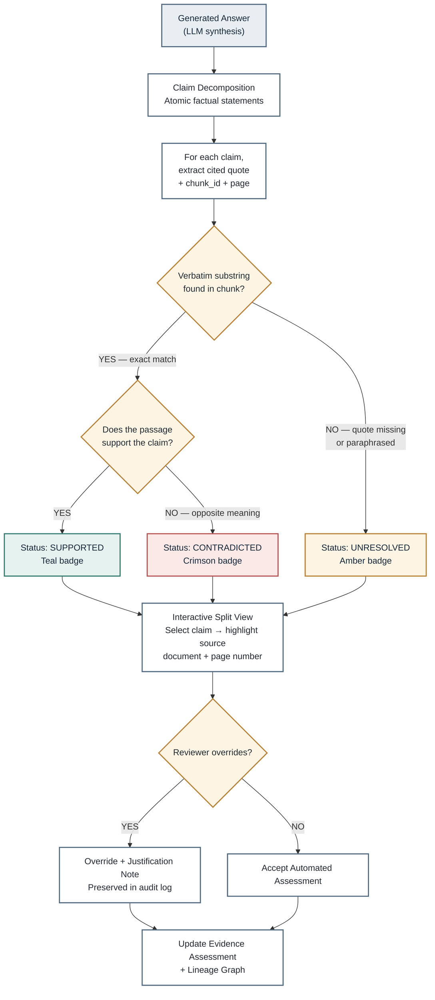

**Status taxonomy (matches the editorial color system in §11):**

| Status | Meaning | Badge color |
|--------|---------|-------------|
| `Supported` | Exact verbatim quote found, and the passage semantically supports the claim | Restrained Teal `#347C70` |
| `Contradicted` | Passage found but proves the opposite of what the claim asserts | Muted Crimson `#B65353` |
| `Unresolved` | No verbatim match — citation mismatch, paraphrase, or fabricated quote | Muted Amber `#B98237` |

---

## 5. Evidence Lineage Graph

The Lineage Graph makes the entire evidence chain **inspectable**. It is not just a debug view — it is a compliance artifact.

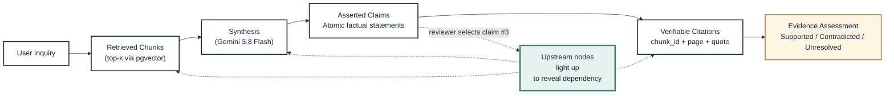

An **accessible tabular view** mirrors the graph for screen-reader and keyboard users, ensuring WCAG compliance for reviewers who cannot rely on visual node highlighting.

---

## 6. Contradiction & Change-Impact Analysis

When a document is amended — for example, a clinical protocol changing from *"25 mg twice daily"* (v1) to *"50 mg once daily"* (v2) — every downstream answer, student note, and evaluation case that depended on the original passage must be flagged for re-review.

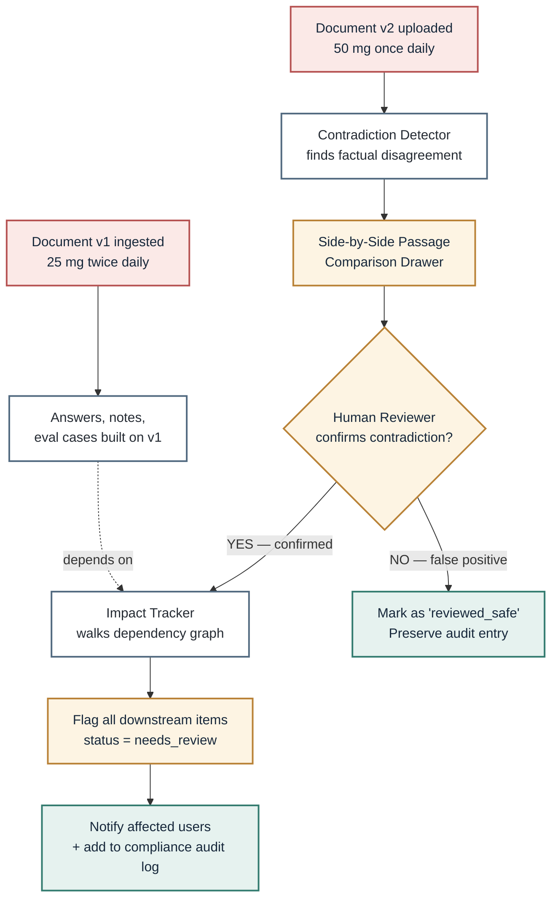

**Why this matters:** Without impact tracking, amending a source document silently invalidates every answer that was ever grounded in it — and nobody finds out until the wrong information causes harm. PaperTrail makes that risk visible the moment a new version lands.

---

## 7. Developer Regression Lab & Adversarial Stress Tests

The Developer Regression Lab treats RAG quality as an engineering discipline, not a one-time tuning exercise. It runs parameterized benchmarks and exposes a curated suite of adversarial scenarios that probe known failure modes.

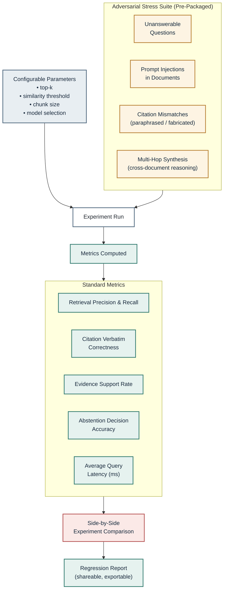

**Adversarial test philosophy:** the suite is not there to make the system look good — it exists to make the system *fail in a controlled way* so that real failures in production are rare.

---

## 8. End-to-End Request Lifecycle

The following sequence diagram traces a single user query from the moment it enters the application to the moment the answer lands on screen — with all safety, retrieval, and verification steps in between.

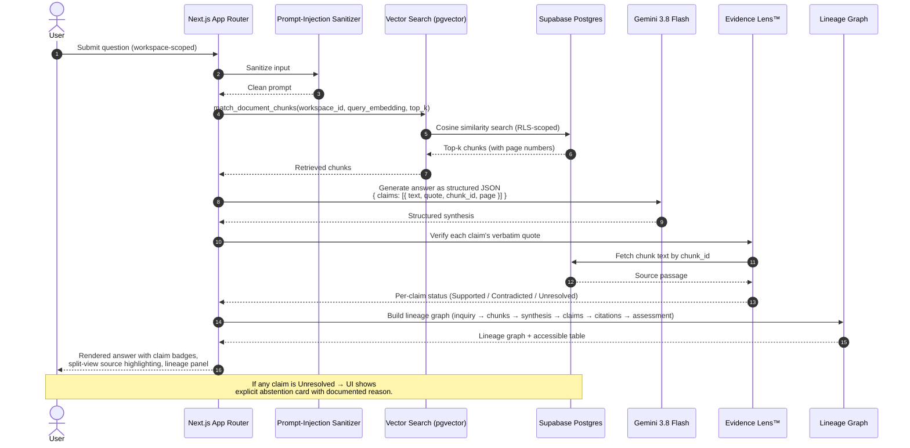

---

## 9. Database Schema (ERD)

The persistence layer is a normalized PostgreSQL schema hosted on Supabase, extended with `pgvector` for embedding storage and similarity search. The diagram below shows the core entities and their relationships.

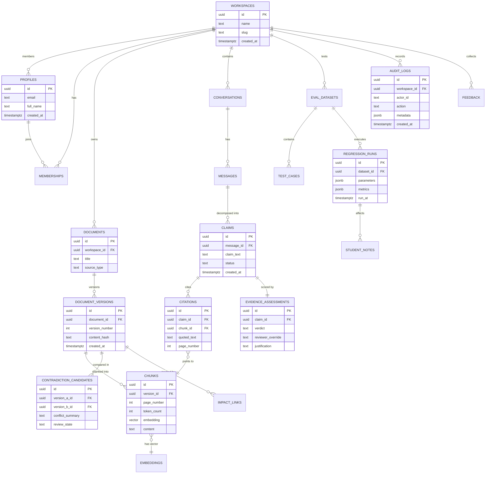

**Migration policy:** schema changes are versioned under `supabase/migrations/` and never destructive — a consolidated `supabase/full_schema.sql` is published for fresh installs.

---

## 10. Security & Multi-Tenancy Model

PaperTrail is built for multi-tenant SaaS deployment from day one. Workspace isolation is enforced at **three reinforcing layers** — defense-in-depth, not defense-by-hope.

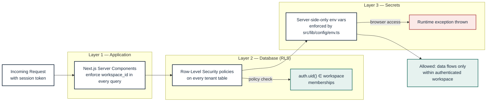

**Verified by test:** `tests/workspace-isolation.test.ts` exercises multi-tenant vector filtering and confirms that a workspace A query can never retrieve chunks belonging to workspace B.

---

## 11. Editorial Design Language

PaperTrail deliberately rejects the generic "AI dashboard" aesthetic — no neon outlines, no glowing orbs, no decorative neural networks, no oversized chat bubbles. Instead, it draws from **analytical publishing, clinical research platforms, and judicial evidence archives**.

| Semantic Token | Hex Code | Purpose |
| :--- | :--- | :--- |
| **Deep Ink Navy** | `#17283B` | Primary headers, active navigation, focused lineage nodes |
| **Muted Slate Blue** | `#526A80` | Subtitles, secondary chrome, inactive tabs |
| **Warm Off-White** | `#F7F6F2` | Workspace background, body canvas |
| **Pure White** | `#FFFFFF` | Card surfaces, modals, passage highlight boxes |
| **Pale Blue-Grey** | `#E8EEF2` | Subtle borders, table headers, node links |
| **Graphite Text** | `#252B33` | Primary body typography and claim content |
| **Restrained Teal** | `#347C70` | Verified & supported status badges |
| **Muted Amber** | `#B98237` | Unresolved claims & contradiction warnings |
| **Muted Crimson** | `#B65353` | Contradicted claims & citation mismatch errors |

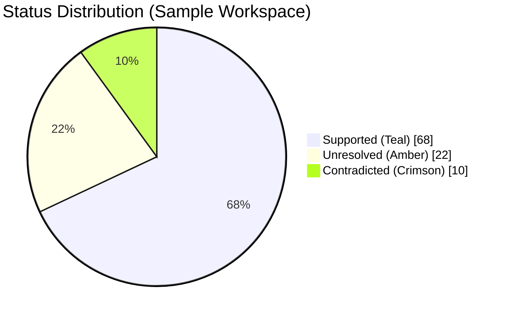

The palette is deliberately **muted and editorial** — the visual energy goes into typography, evidence highlighting, and lineage graph structure, not into decorative gradients.

---

## 12. Project Structure

```
paper-trial-evidence-lab/
├── src/
│   ├── app/                     # Next.js 14 App Router pages & API routes
│   ├── components/              # React UI components (Evidence Lens, Lineage Graph, etc.)
│   ├── lib/
│   │   ├── config/env.ts        # Server-side-only secret enforcement
│   │   ├── chunker/             # Boundary-preserving chunker
│   │   ├── sanitizer/           # Prompt-injection sanitizer
│   │   ├── citation-validator/  # Verbatim quote verification
│   │   ├── evidence-lens/       # Claim decomposition & assessment
│   │   ├── lineage/             # Lineage graph builder
│   │   ├── contradiction/       # Cross-version contradiction detector
│   │   ├── impact-tracker/      # Downstream dependency tracker
│   │   └── supabase/            # Supabase client & RLS helpers
│   └── types/                   # Shared TypeScript types (Zod-validated)
├── supabase/
│   ├── migrations/              # 8 versioned SQL migrations
│   └── full_schema.sql          # Consolidated schema for fresh installs
├── tests/                       # Vitest suites (15 tests across 8 suites)
├── .env.example
├── .gitignore
├── README.md
├── next.config.mjs
├── package.json
├── postcss.config.js
├── tailwind.config.ts
├── tsconfig.json
└── vitest.config.ts
```

**Tech stack:**

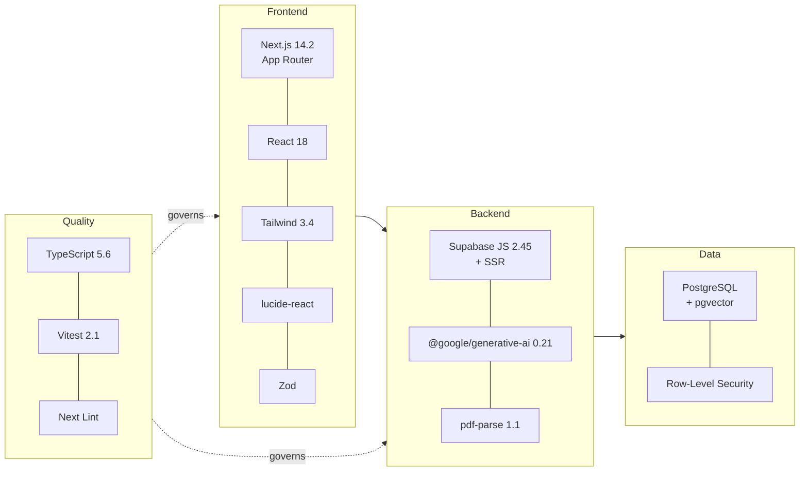

---

## 13. Quick Start

### Prerequisites

- **Node.js** v20+
- **npm** v10+
- A **Supabase** project (free tier is fine)
- A **Google Gemini** API key

### Step 1 — Clone & Install

```bash
git clone https://github.com/reenuasrin2008/paper-trial-evidence-lab.git
cd paper-trial-evidence-lab
npm install
```

### Step 2 — Configure Environment

```bash
cp .env.example .env.local
```

Edit `.env.local`:

```env
# Supabase Configuration (Client-safe)
NEXT_PUBLIC_SUPABASE_URL=https://your-project.supabase.co
NEXT_PUBLIC_SUPABASE_PUBLISHABLE_KEY=your_anon_publishable_key

# Google Gemini API Configuration (Server-side privileged only)
GEMINI_API_KEY=your_gemini_api_key
```

> **Security verification:** `.env.local` is strictly excluded in `.gitignore`. Privileged secrets like `GEMINI_API_KEY` are enforced as server-side only in `src/lib/config/env.ts` and will **throw runtime exceptions** if accessed in browser code.

### Step 3 — Apply Database Migrations

1. Open your [Supabase Dashboard](https://supabase.com/dashboard).
2. Navigate to **SQL Editor → New Query**.
3. Paste the contents of `supabase/full_schema.sql` and click **Run**.
4. Enable the **Vector** extension under **Database → Extensions** if not already enabled.

### Step 4 — Run the Application

```bash
# Production mode
npm run build
npm start

# Development mode
npm run dev
```

Open [http://localhost:3000](http://localhost:3000) in your browser.

### Quick Start Flow

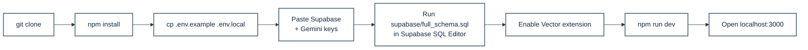

---

## 14. Automated Tests

Run the full automated test suite using Vitest:

```bash
npm test          # one-shot
npm run test:watch  # watch mode
```

### Verified Test Suite — 15 tests passing across 8 suites

| Suite | File | What it verifies |
|-------|------|-----------------|
| Chunker | `tests/chunker.test.ts` | Boundary-preserving chunking, page numbers, overlap, token counts |
| Sanitizer | `tests/sanitizer.test.ts` | Neutralization of prompt injections (`ignore previous instructions`, etc.) |
| Citation Validator | `tests/citation-validator.test.ts` | Verbatim quote verification & citation mismatch detection |
| Evidence Lens | `tests/evidence-lens.test.ts` | Claim extraction, citation validation against chunks, support rate calculation |
| Lineage | `tests/lineage.test.ts` | Evidence Lineage Graph node & edge generation |
| Contradiction | `tests/contradiction.test.ts` | Polar conflict detection across documents, human review transitions |
| Impact Tracker | `tests/impact-tracker.test.ts` | Downstream dependency tracking on updated document versions |
| Workspace Isolation | `tests/workspace-isolation.test.ts` | Multi-tenant workspace data isolation & vector filtering |

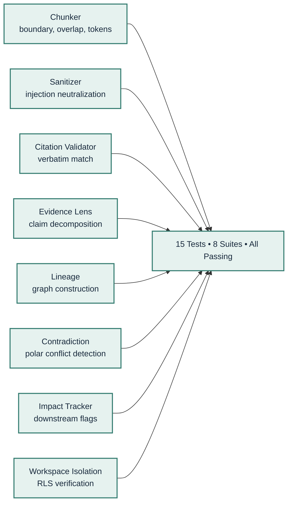

---

## 15. Database Migrations

Versioned migrations are located in `supabase/migrations/`:

| # | Migration File | Purpose |
|---|----------------|---------|
| 1 | `00001_initial_schema_and_extensions.sql` | Enables `uuid-ossp`, `pgcrypto`, and `vector` (pgvector) |
| 2 | `00002_profiles_workspaces_memberships.sql` | User profiles, workspaces, role memberships |
| 3 | `00003_documents_versions_chunks.sql` | Document versions, chunks, similarity search RPC `match_document_chunks` |
| 4 | `00004_conversations_claims_citations.sql` | Conversations, messages, claims, citations, evidence assessments |
| 5 | `00005_contradictions_and_impact.sql` | Contradiction candidates and document impact dependency links |
| 6 | `00006_evaluations_experiments_stress.sql` | Eval datasets, test cases, regression runs, student notes |
| 7 | `00007_audit_and_feedback.sql` | Document collections, privacy-safe audit logging, human feedback |
| 8 | `00008_rls_policies.sql` | Comprehensive Row-Level Security enforcing workspace data isolation |

**Migration dependency flow:**

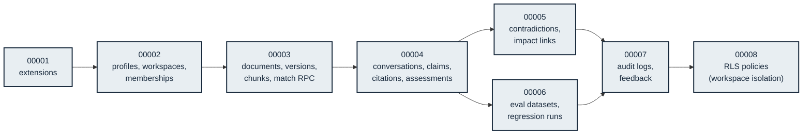

---

## 16. Deployment

The project is structured for **zero-config Vercel deployment**.

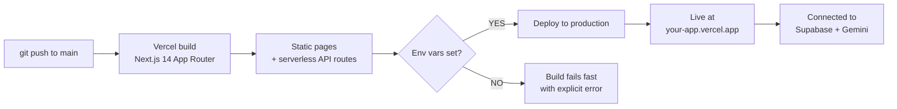

**Steps:**

1. Connect your GitHub repository to Vercel.
2. In **Project Settings → Environment Variables**, configure:
   - `NEXT_PUBLIC_SUPABASE_URL`
   - `NEXT_PUBLIC_SUPABASE_PUBLISHABLE_KEY`
   - `GEMINI_API_KEY`
3. Deploy! Next.js will build the static pages and deploy the API route handlers as serverless functions.

**Other deployment targets:** the app is a standard Next.js 14 build, so any platform that supports Node.js serverless functions (Netlify, Railway, Fly.io, AWS Amplify, self-hosted Docker) works equally well.

---

## 17. Roadmap

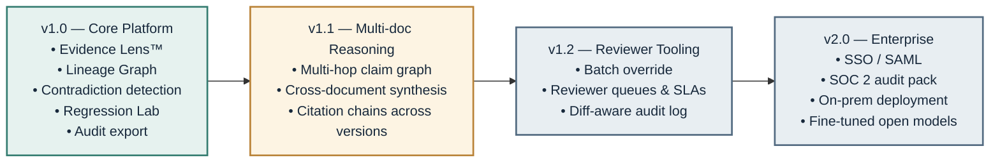

---

## 18. Contributing

Contributions are welcome. The project follows a standard fork → branch → PR workflow:

1. Fork the repository.
2. Create a feature branch: `git checkout -b feat/your-feature`.
3. Make changes; ensure `npm test` passes.
4. Run `npm run lint` to satisfy the project's style rules.
5. Open a pull request describing the change, the rationale, and any tests added.

**What we especially welcome:**

- New adversarial stress-test scenarios for the Developer Regression Lab.
- Improvements to the citation validator's verbatim-match heuristic.
- Accessibility enhancements to the Lineage Graph and Evidence Lens UI.
- Additional language support in the document chunker (currently English-focused).

---

## 19. License

Released under the **MIT License**. See [`LICENSE`](LICENSE) for full text.

---

<div align="center">

**PaperTrail Evidence Lab** — *Every important answer must be traceable to its source evidence.*

Built with Next.js · Supabase · pgvector · Google Gemini · TypeScript · Vitest

</div>
